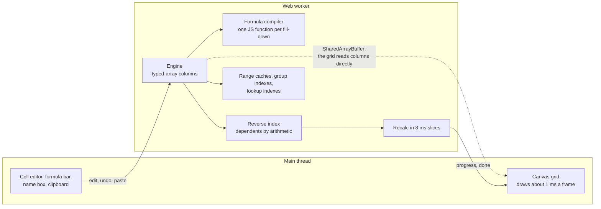
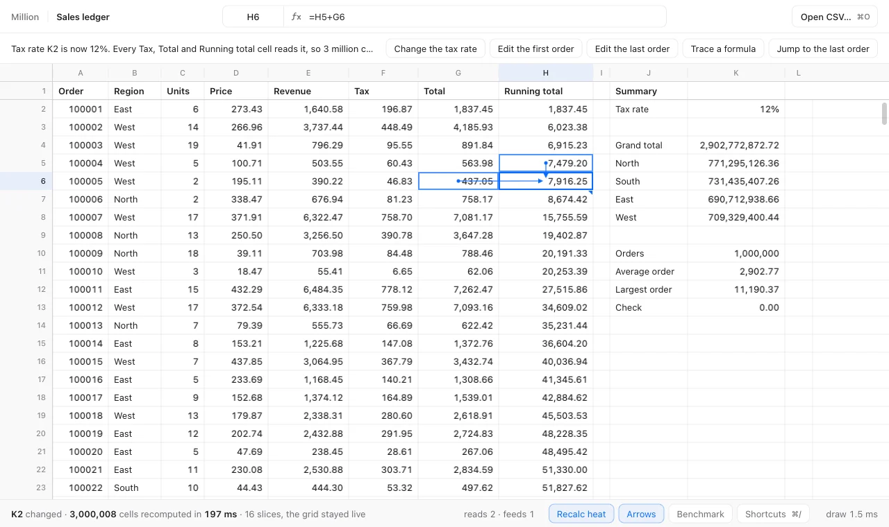

# Million

[](https://github.com/DevSrijit/million/actions/workflows/ci.yml)

A spreadsheet engine for the browser, written from scratch. It holds a million rows with every formula live.

Change one cell, and only the cells that depend on it recalculate. A small edit takes microseconds. An edit that touches 3 million cells runs in slices on a worker, and the grid keeps scrolling while it works.

**Try it: [millionrows.vercel.app](https://millionrows.vercel.app)**. The cursor on the landing page is a script that drives the real engine. Click the sheet to take it over, or open [the full app](https://millionrows.vercel.app/sheet).


Everything runs on your machine. There is no server, no account and no upload. A CSV that you open stays in the page.

## The numbers

The demo workbook is a sales ledger: 1,000,000 orders, 8 columns, 4,000,009 formulas. Every Tax, Total and Running total cell is a live formula, and a summary panel adds up the whole sheet with `SUM`, `SUMIF`, `COUNT`, `AVERAGE` and `MAX`.

Chrome 156, production build, M5 MacBook Air:

| What | Cells recomputed | Time |
| --- | ---: | ---: |
| Load: build the sheet and calculate every formula | 4,000,009 | about 0.25 s |
| Change the units of one order | 12 | 3 µs |
| Change the region of one order (moves it between `SUMIF` totals) | 4 | 1 to 3 µs |
| Change the units of the first order (the running total of every row after it) | 1,000,011 | 66 to 69 ms |
| Change the tax rate that every row reads | 3,000,008 | 185 ms, in 8 ms slices |
| Open a 56.5 MB CSV with 1,000,000 rows | – | about 0.55 s, from drop to sheet |
| Drag the scrollbar from top to bottom | – | about 24,400 rows a frame at 60 fps |

The engine keeps the sheet in 129 MB of typed arrays.

### Against HyperFormula

[HyperFormula](https://hyperformula.handsontable.com) is the strongest open-source JavaScript formula engine. Both engines ran the same ledger in Bun 1.4.4 on the same machine, and both gave the same values.

| 1,000,000 orders | Million | HyperFormula 3.5.0 |
| --- | ---: | ---: |
| Build and calculate | 0.2 s | 84.6 s |
| Peak memory | 187 MB | about 7.4 GB |
| Change the units of one order | 0.005 ms | 2,062 ms |
| Change the tax rate | 147 ms | 12,006 ms |

HyperFormula does much more than Million: hundreds of functions, named ranges, sheets that reference each other, and an undo history of structural changes. The comparison shows what a narrow engine built around this kind of workbook can do. It does not say that HyperFormula is slow at its own job. The full tables are in [the phase 1 report](docs/phase-1-report.md).

## How it works



### One function per column

A formula is parsed into an AST with every reference stored relative to its own cell. `=C2*D2` in row 2 and `=C3*D3` in row 3 give the same AST, so a filled-down column compiles once, with `new Function`, into one JavaScript function that takes the row. The ledger's 4,000,009 formulas need 11 functions.

### Dependents by arithmetic

No cell stores a list of the cells that read it. Each compiled formula registers its shape once in a reverse index. When G5 changes, the index works out from the shapes that H5 reads it (`=H4+G5`) and that `SUM(G:G)` covers it. A whole-column range is one index entry, not a million edges.

### Totals that keep themselves

Every write goes through one function, which tells the column's watchers the old and the new value.

- `SUM`, `COUNT`, `AVERAGE`, `MIN` and `MAX` over a tall range keep a cached total and apply the difference. The sum uses compensated addition, so a total built from a million differences still matches a fresh scan.
- `SUMIF` and `COUNTIF` keep a group index: one bucket per key. Changing an order's region moves one row between two buckets.
- `MATCH`, `VLOOKUP` and `XLOOKUP` with an exact match keep a hash index from key to row.

So changing one order never adds up a million rows again.

### Work in slices

The recalculation is a depth-first search with its stacks in typed arrays, so it can stop at any cell and start again later. The worker runs it in 8 ms slices. Between slices it answers the grid, so scrolling stays smooth and cells update in place as they finish. A cell that the recalculation has not reached yet draws faded.

### A grid that reads engine memory

The page is cross-origin isolated (COOP and COEP headers), so the engine's columns live in SharedArrayBuffers. The canvas grid reads values straight from engine memory on each frame and draws digits from a glyph atlas. A scrollbar drag across a million rows never waits for a message, and no placeholder rows show.

## Honesty rules

- A million rows is not more than Excel. The ledger has 1,000,001 rows, and Excel allows 1,048,576. The point is that every formula in the sheet stays live and a small edit costs microseconds.
- Every number on this page and on the site was measured, and the method is in the reports in `docs/`. The times change with the machine and the browser.
- Million is a study of one engine design, not a replacement for Excel or Sheets. It has one sheet, no saving, no charts and the functions listed below.

## Functions

`SUM` `COUNT` `COUNTA` `AVERAGE` `MIN` `MAX` `SUMIF` `COUNTIF` `SUMIFS` `COUNTIFS` `IF` `IFERROR` `AND` `OR` `NOT` `ABS` `INT` `SQRT` `MOD` `POWER` `ROUND` `LEN` `UPPER` `LOWER` `CONCAT` `MATCH` `VLOOKUP` `XLOOKUP` `INDEX` `DATE` `YEAR` `MONTH` `DAY`

Operators: `+ - * / ^ & % = <> < > <= >=`. References: `A1`, `$A$1`, `A1:B9` and whole columns like `G:G`. A cycle gives `#CYCLE!` in every cell that reads it, whatever the evaluation order.

## Using the sheet



It works like Excel and Sheets. Double-click a cell or start typing to edit it. While you type a formula, click or drag on cells to put their references in. Select a range to see its Sum, Average and Count. Copy and paste go through the system clipboard as tab-separated text, so you can paste to and from Excel. A copy inside Million shifts relative references when you paste it, like Excel. On a phone, swipe to scroll, tap to select and double-tap to edit.

Open a CSV with **Open CSV…** or drop it on the sheet. The file is read in the worker, and its column types and widths are found from the data.

Press `⌘/` to see every shortcut. The most used keys:

| Key | Action |
| --- | --- |
| `Return` | Edit, or save and move down |
| `⌘Return` | Save and stay |
| `Tab` | Save and move right |
| `F2` | Edit with the arrow keys moving the caret |
| `F4` | Make a reference absolute (`A1` → `$A$1` → `A$1` → `$A1`) |
| `⌘Z` `⇧⌘Z` | Undo, redo |
| `⌘↑` `⌘↓` | Jump to the first or last row |
| `⌃G` | Go to a cell |
| `⌘O` | Open a CSV |

## Run it on your computer

You need [Bun](https://bun.sh) 1.4 or later.

```bash
bun install
```

```bash
bun dev
```

Then open http://localhost:3000.

Other commands:

```bash
bun test
```

```bash
bun run build
```

```bash
bun run bench
```

`bun run bench` runs the engine benchmark on the ledger in Bun. Give it a row count to change the size, for example `bun bench/engine.ts 100000`.

The HyperFormula comparison is in `bench/hyperformula/`, with its own `package.json`. HyperFormula is GPL-3.0 licensed. The app never imports it, and it is not installed with the app. To run it:

```bash
cd bench/hyperformula && bun install && bun hf.ts 100000
```

## Tests

`bun test` runs 56 tests. The main ones:

- **Differential tests.** Random edits run against the engine with every cache and index on, and the result must equal a fresh full calculation, cell for cell. Another test stops the sliced recalculation after every cell and reads values in between.
- **Batch tests.** A paste of many cells must give the same values as the same writes one at a time, and recompute a shared dependent once.
- **Interaction logic** is in plain modules with their own tests: the wheel's soft axis lock, touch panning with momentum, and the landing page's autopilot.

## How the code is set up

| Path | What it holds |
| --- | --- |
| `engine/parser.ts` | The formula parser, the printer, and reference shifting for paste |
| `engine/sheet.ts` | The engine: columns, the compiler, the reverse index and the sliced recalculation |
| `engine/caches.ts` | Range caches, group indexes and lookup indexes |
| `engine/worker.ts` | The web worker: edits, undo and redo, paste, CSV import, the benchmark |
| `engine/csv.ts` | The streaming CSV parser |
| `engine/demo.ts` | The million-order ledger |
| `components/Grid.tsx` | The canvas grid, the editor, selection, the clipboard and the shortcuts |
| `components/autopilot.ts` | The landing page's scripted cursor |
| `components/axis-lock.ts` | The soft axis lock for trackpad scrolling |
| `components/touch-pan.ts` | Touch panning and momentum |
| `app/` | The landing page (`/`) and the app (`/sheet`) |
| `docs/` | The reports from each phase, with the measurements |

Built with Next.js 16, React 19 and TypeScript. The engine and the grid use no libraries.

## Author

Built by Srijit Ghosh.

## License

[MIT](LICENSE)
